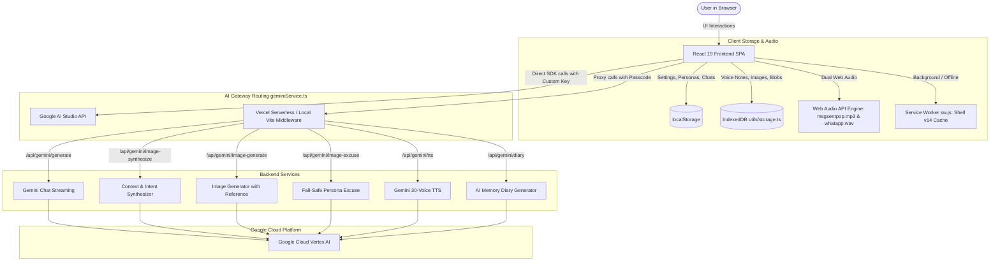
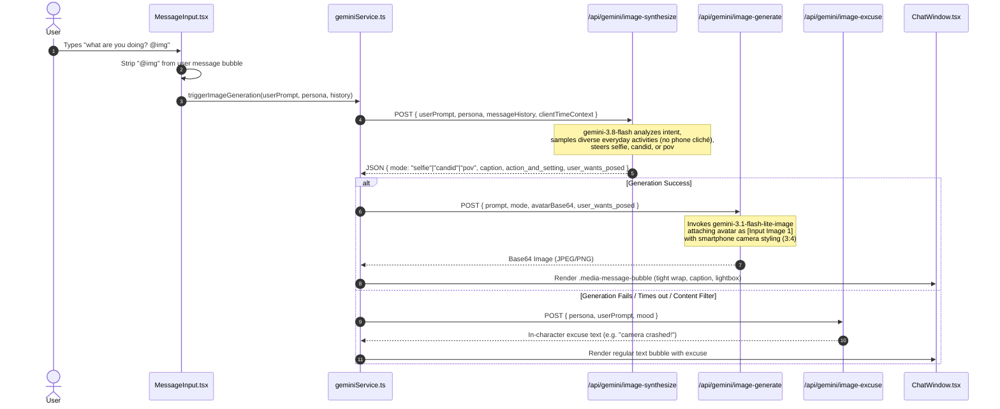
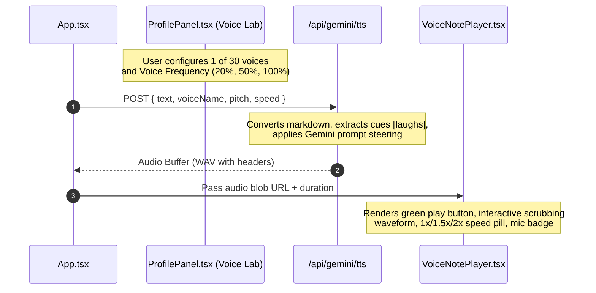
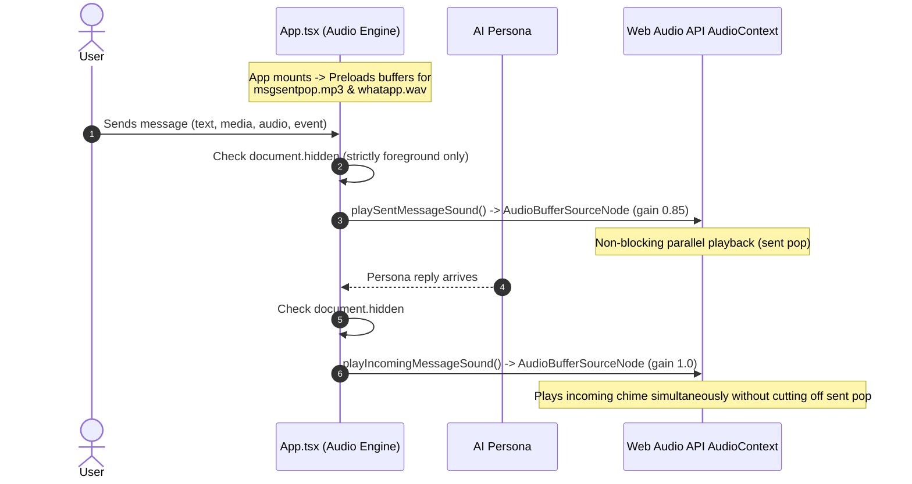
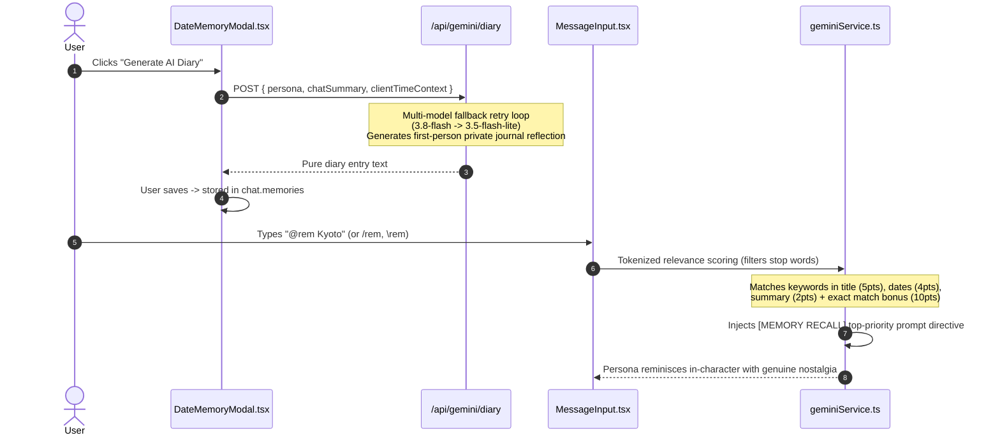

# Wassap System Architecture (`architecture.md`)

## Persona calling implementation (18 October 2026)

`services/liveCall.ts` owns the call lifecycle independently of the full/compact `CallOverlay` presentation. It uses the installed GenAI Live SDK directly for personal-key mode, or binary PCM over a same-origin `/api/gemini/live` WebSocket relay for Built-in Cloud. That standalone HTTP server validates the existing member cookie and Origin before upgrade, resolves server credentials, bounds frames/buffers/duration and closes its upstream session with its client. Vite dev/preview attach its upgrade handler; Vercel serves the exported HTTP server and requires WebSocket/Fluid Compute support. The relay uses `VERTEX_LIVE_LOCATION` (`us-central1` default), a fixed Live model and a dedicated 300-second function duration.

`public/call-capture.js` captures/resamples microphone audio off the UI thread to 16 kHz mono PCM. Response PCM is scheduled at 24 kHz through Web Audio and an audio element. Interruption stops queued sources; mute stops transmission/disables microphone tracks; hang-up releases tracks, nodes, sockets, timers and the cross-tab Web Lock. Session handles are ephemeral in memory; resume excludes reconnect gaps from connected duration. No shared cloud credential reaches browser code.

`utils/voiceSelection.ts` shares voice identity priority and delivery settings between voice notes and calls. Built-in Live voice names match the persona's selection. Custom TTS IDs are not sent as Live voice names: an available session-cached designed/replicated preview can be converted by the existing audio resampler to 10–20 seconds of mono 24 kHz PCM and submitted as `replicatedVoiceConfig` over the authenticated Cloud relay. Google restricts this to enabled Vertex projects. Personal-key mode or missing/short previews explicitly disclose a prebuilt fallback; submitted custom sample rejection ends the call. No new persistent sample storage is introduced; audible identity still requires testing.

Startup summarizes only the latest 20 text messages (2,000 characters each) while a locally synthesized ringback runs for 6–12 seconds. Authenticated HTTP POST `/api/gemini/live` summarizes with the existing text location (global default); personal keys call the text model directly. Live receives only persona name/description, voice delivery and the capped 1,600-character summary. Full persona instructions, user profile, diary memories, schedules, clock context and raw messages are excluded. Summary failures stop setup; End aborts preparation. Ringback and reconnect time do not count toward connected duration, and microphone frames wait for pickup.

Both provider routes use automatic VAD with low start/end sensitivity, 200 ms prefix padding, 900 ms silence and normal speech interruption. Capture requests echo/noise cancellation without automatic gain and emits 40 ms PCM batches. Playback retains a small scheduling margin; server-confirmed interruptions clear queued sources and mark partly heard transcript turns. All captured transcripts are committed to dated chat event cards before clearing recovery data. Calls of at least 60 seconds with usable text receive a diary plus an expandable card summary; ordinary AI history then uses that dated summary while the full transcript stays in the card. Start/end timestamps and connected duration make call timing explicit. Shell cache v21 includes the bundled CC0 ringback recording and capture worklet; browser storage keys remain unchanged.

Ringback uses a dedicated HTML audio element, exempt from competing-media pauses, at a six-second cadence during the random pickup delay. Audio toggles it and pickup/End stop it. `Chat.timeAwarenessEnabled` defaults on when absent and is preserved in profile updates and persona backups. All gap/frequency-context callers and text prompt paths honor off, including notification replies, while the independent global clock-sharing and scheduled automation controls are retained.

`utils/calls.ts` adds a separate `wassap_calls` IndexedDB database/store for incremental recovery and diary jobs, without changing existing databases/keys. Optional `Message.call` renders call-history cards; optional `MemoryBubble.callId` deduplicates automatic diary memories. Full-call text is sent as one explicitly labeled event to the existing diary pipeline to avoid its 80-message single-day tail limit. Jobs keep their generated result until chat-memory storage succeeds; temporary recovery turns are discarded only after the short-call transcript or long-call summary is committed to chat storage. Memory toggles are preserved. Chat deletion/clear/message deletion remove corresponding recovery records.

The root retains the called persona while browsing; sends queue and automations/foreground responses pause for that persona. The service worker defers notification replies into the existing outbox, and handles a call-specific notification End intent with a durable call-ID-scoped CacheStorage marker. Native notification appearance/background execution are browser-dependent. This cache is preserved by shell-cache refreshes. Generic real Google probes verified tuned Live setup/noise rejection/synthesized speech recognition and global text summarization; physical Android and deployed hosting validation remain outstanding.

## v1.9.7 conversation layout

The mobile inbox heading invokes a normal location reload. Existing service-worker network-first navigation requests the current shell online, with cached fallback offline; startup checks for service-worker updates. No cache deletion, worker unregistration or storage reset is performed. Release version stays 1.9.7.

`ChatWallpaper` renders once behind both the message viewport and composer. A ResizeObserver tracks the conversation pane; on mobile it retains the largest height for the current width, so keyboard/composer height changes reveal or hide the photo instead of changing its crop. Width/orientation changes reset the size, and desktop follows pane resizing. No storage migration is involved; the observer disconnects on unmount. `utils/wallpaper.ts` owns sizing and retired-preset resolution.

The composer textarea suppresses its clipped outline; keyboard focus indicators remain on buttons and other inputs. Dedicated low-alpha divider tokens soften decorative chat-list/navigation lines without weakening form borders. Shell cache v18 refreshes release assets; existing localStorage/IndexedDB keys and PWA identity are unchanged.

This document provides a comprehensive technical overview of the architecture, data flow, tech stack, and directory structure of the **Wassap Persona Simulation** platform (v1.9.7).

## Android mobile polish (18 October 2026)

Chat-list selection is local UI state in `ChatList.tsx`; row pointer timers cancel on movement/unmount. Batched `onSetChatFlags` updates from `App.tsx` merge only `archived`/`pinned` metadata into selected records. Optional `Chat.pinned` uses the existing localStorage format and defaults false; stable sorting changes presentation without rearranging or replacing persisted chat arrays. Selection uses a temporary mobile history entry, removed when selection ends. Desktop selection remains active alongside an open conversation. This follow-up originally shipped with shell cache v17; no provider/backend changes.

Archive follow-up adds only optional `Chat.archived` metadata to existing records; no schema/store rename or destructive migration. Filters hide archived records from the main inbox while generation and background replies still use the full chat collection. Mobile navigation transitions keep inbox/chat mounted; profile exit waits 220ms before normal close/history cleanup. This archive follow-up originally shipped with shell cache v16. The focused archive/navigation browser check is `tests/archive-ui.browser.js`.

Presentation changes reuse the existing React components and Lucide icon dependency. No new runtime packages, API endpoints, authentication paths, model choices or storage schemas were introduced. Desktop and mobile now share a consistent 768px breakpoint; `.app-shell` uses a dynamic viewport with a legacy fallback.

`App.tsx` manages mobile panel focus/background isolation through `data-app-panel` and `data-panel-close`. Its observer handles lazily mounted panels. Existing history handling consumes entries on explicit panel close; cancelable `wassap:back` events let chat menus/selection/trays dismiss before leaving a conversation. Component effects remove listeners and timers on cleanup. These UI events do not send messages or modify provider settings.

`utils/wallpaper.ts` resolves one known retired forest URL only at render time, leaving saved settings and custom URLs intact. The new forest SVG is bundled. Service-worker shell cache v15 refreshes presentation assets while leaving IndexedDB/localStorage and notification-generation logic unchanged.

`tests/mobile-ui.browser.js` is a Playwright CLI function using a fresh context, blocked service workers, synthetic keys/voice/media/outbox fixtures and browser UI interaction. It complements `npm test`'s provider/security checks and the wallpaper resolver test; physical Android and live paid-provider verification remain separate.

---

## 🏗️ 1. High-Level System Architecture

Wassap is structured as a client-first Single Page Application (SPA) designed to run with zero external database dependencies. All state is maintained client-side via `localStorage` and `IndexedDB`, while AI intelligence is routed through a dual-provider gateway:



---

## 🔄 2. Core Workflows & Data Pipelines

### A. In-Chat Realistic Smartphone Photo Generation (`@img` / `@image`)



### B. Dual-Engine Audio & Gemini-TTS Pipeline



### C. Dual In-App Audio Sound System (`msgsentpop.mp3` & `whatapp.wav`)



### D. Pure AI Diary Generation & `@rem` Memory Recall Pipeline



---

## 📂 3. Folder & File Structure

```
Wassap/
├── .github/                      # CI/CD and repository workflows
├── api/                          # Vercel Production Serverless Functions
│   └── gemini/
│       ├── generate.ts           # Streaming and non-streaming persona chat responses
│       ├── image.ts              # Consolidated multi-action image endpoint
│       ├── image-synthesize.ts   # Step 1: Context & intent synthesizer
│       ├── image-generate.ts     # Step 2: Realistic smartphone image generator
│       ├── image-excuse.ts       # Step 3: Camera error in-character excuses
│       ├── tts.ts                # 30-Voice Gemini-TTS voice synthesis
│       ├── diary.ts              # Persona diary generator for memory bubbles
│       └── status.ts             # Health check & credentials diagnostic endpoint
├── components/                   # Modular React UI Components
│   ├── CalendarNotesWidget.tsx   # Shared notes & real-time context panel
│   ├── ChatList.tsx              # Left sidebar conversation list with unread counters
│   ├── ChatWindow.tsx            # Main chat viewport, message cards, grouping, media bubbles
│   ├── ConfirmationModal.tsx     # Generic confirmation dialog for deletions/resets
│   ├── EmojiPickerTray.tsx       # WhatsApp-native unclipped emoji drawer with search & recents
│   ├── GuidePanel.tsx            # In-app user manual & tips
│   ├── ImageLightboxModal.tsx    # Full-screen media viewer with download capability
│   ├── MessageInput.tsx          # Message composer, @img trigger, audio recording, emoji/events
│   ├── MobileActionFAB.tsx       # Floating Action Button for mobile screen transitions
│   ├── MobileNavigation.tsx      # Bottom navigation bar for mobile viewports
│   ├── NewChatPanel.tsx          # Persona creation & search interface
│   ├── NewGroupPanel.tsx         # Multi-persona group chat creator
│   ├── ProfilePanel.tsx          # Comprehensive persona editor (Voice, Sentience, Schedule, Humane)
│   ├── ReactionTray.tsx          # Anchored spring-animated floating emoji reaction tray
│   ├── SettingsPopover.tsx       # Global preferences (Providers, Keys, Passcode, Wallpaper, Models)
│   ├── Sidebar.tsx               # Left navigation rail (Chats, Communities/Guide, Updates, Settings)
│   ├── UpdatesPanel.tsx          # In-app changelog timeline
│   ├── UserProfilePanel.tsx      # Personal user profile info
│   └── VoiceNotePlayer.tsx       # WhatsApp audio note card with waveform scrubber & speed pill
├── server/                       # Local Development Backend
│   ├── api.ts                    # Vite Connect middleware forwarding /api/gemini/*
│   └── vertexHandler.ts          # Server-side Vertex AI implementation mirror
├── services/
│   └── geminiService.ts          # Client-side gateway orchestrator (routes Vertex vs AI Studio)
├── utils/
│   ├── audio.ts                  # Web Audio API recording, PCM converter, WAV header builder
│   ├── dates.ts                  # Monotonic chronological date grouping ("Today", "Yesterday", 24h clock)
│   ├── haptics.ts                # Multi-pattern tactile haptic vibration engine
│   ├── imageCompressor.ts        # Client-side canvas image compression
│   └── storage.ts                # IndexedDB persistence for large audio & image blobs
├── public/                       # Static public assets
│   ├── msgsentpop.mp3            # Authentic low-pop sent message sound
│   ├── whatapp.wav               # Incoming message chime
│   ├── sw.js                     # Service Worker (PWA offline shell v14 & background push)
│   ├── manifest.json             # Web App Manifest
│   └── images/                   # Wallpapers and default avatars
├── App.tsx                       # Root application component, Web Audio engine, & global state orchestrator
├── constants.ts                  # Default personas, templates, wallpapers, model catalogues
├── index.css                     # Tailwind CSS base & custom WhatsApp variables
├── index.html                    # HTML entry point
├── index.tsx                     # React DOM root mounting
├── tailwind.config.js            # Tailwind v3 layout configuration
├── tsconfig.json                 # TypeScript compiler options
├── types.ts                      # Core TypeScript domain models
├── vercel.json                   # Vercel serverless routing & function definitions
└── vite.config.ts                # Vite build and dev server configuration
```

---

## 🛠️ 4. Technology Stack

| Layer | Technology | Purpose & Details |
| :--- | :--- | :--- |
| **Frontend Framework** | **React 19** (`react`, `react-dom`) | Modern component architecture, state management with hooks |
| **Language** | **TypeScript 5.8** | Static typing across frontend, models, and serverless handlers; strict mode is not enabled |
| **Build Tooling** | **Vite 6** (`@vitejs/plugin-react`) | High-speed HMR development and production asset bundling |
| **Styling** | **Tailwind CSS v3.4** + Custom CSS | WhatsApp theme tokens, CSS variables, dark mode class strategy |
| **Icons** | **Lucide React** (`lucide-react`) | Pixel-accurate WhatsApp UI icon representations |
| **Client AI SDK** | **`@google/genai` v1.38+** | Official Google GenAI SDK for AI Studio and Vertex AI |
| **Audio Processing** | **Web Audio API** | Microphone PCM capture, sample-rate resampling, buffer preloading (`msgsentpop.mp3`, `whatapp.wav`), and parallel non-blocking playback |
| **PWA & Offline** | **Service Worker** (`sw.js`) | Offline app shell caching (`wassap-shell-v14`), background push handling, and action dispatch |
| **Local Backend** | **Vite Connect middleware** | Local development proxy for Vertex AI endpoints |
| **Serverless Engine** | **Vercel Functions** (`@vercel/node`) | Zero-config serverless API deployment in `/api/gemini/*` |
| **Client Storage** | **`localStorage` & IndexedDB** | Lightweight text state + robust binary blob persistence |

---

## 🔐 5. Authentication & Environment Configuration

Wassap employs a dual-credential resolution architecture:

1. **Service Account JSON**:
   - `GCP_SERVICE_ACCOUNT_KEY`, `GOOGLE_APPLICATION_CREDENTIALS_JSON`, or `GOOGLE_CREDENTIALS`.
2. **Individual Service Account Keys**:
   - `GCP_CLIENT_EMAIL` (or `VERTEX_CLIENT_EMAIL`)
   - `GCP_PRIVATE_KEY` (or `VERTEX_PRIVATE_KEY`) with automated `\n` normalization and PEM reconstruction.
3. **API Key Fallback**:
   - `VERTEX_API_KEY`, `GEMINI_API_KEY`, or `API_KEY`.
4. **Passcode Protection**:
   - `/api/gemini/auth` verifies the member passkey on the server and sets an HTTP-only, SameSite=Strict cookie (Secure over HTTPS). All paid endpoints validate it, including voice management and service-worker replies. Explicit legacy passcode headers remain accepted for older clients. `VERTEX_PASSCODE` overrides the compatible legacy validator.


## Maintenance safeguards (18 October 2026)

- The browser contains no shared cloud credential. Custom Gemini keys remain local user settings and are sent only to the Google API in custom-key mode.
- Settings verify the HTTP-only cloud cookie after startup. Existing unlocked installations require one re-entry of their unchanged passkey; data stores and record formats are unchanged.
- Text generation (chat, diary, image caption/excuse, and notification reply) is restricted to `gemini-3.8-flash` and `gemini-3.5-flash-lite`. Separate image and TTS model IDs are unchanged.
- `server/remoteMedia.ts` resolves all DNS answers, blocks non-public IPs, pins the checked IP for the HTTP request, rechecks redirects, and bounds the entire download by time and byte count. The same guard is embedded in standalone image/chat endpoints to preserve Vercel self-containment. Tests enforce parity.
- `utils/personaBackup.ts` validates flat legacy exports and wrapped exports before adding a persona; it leaves valid profile data intact.
- `api/gemini/auth.ts` is self-contained. The local Vite middleware reuses it; production API handlers do not import other local files.
- `.github/workflows/verify.yml` uses a frozen install, tests, TypeScript, production build, and a production dependency audit. Tailwind 3 build-only advisories are recorded in README with a review date.

- Legacy inline images without media IDs are preserved during load/save. Media writes/deletes report completion only after IndexedDB commit and close their connections. Pending sends are held while cloud access is locked, then resumed after successful unlock.
- The invalid Google Fonts request for the system Segoe UI font was removed; existing system-font styling is unchanged.
